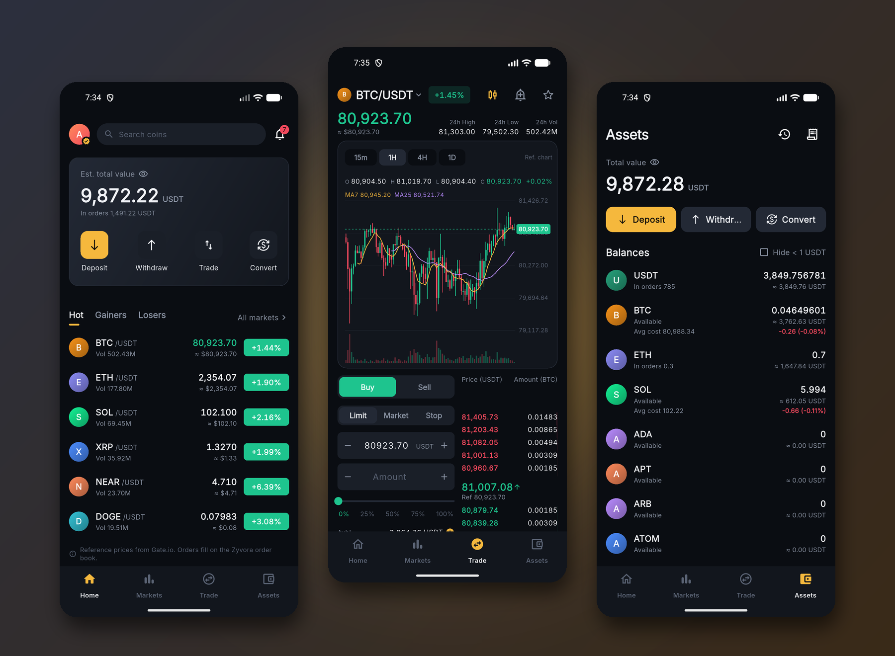
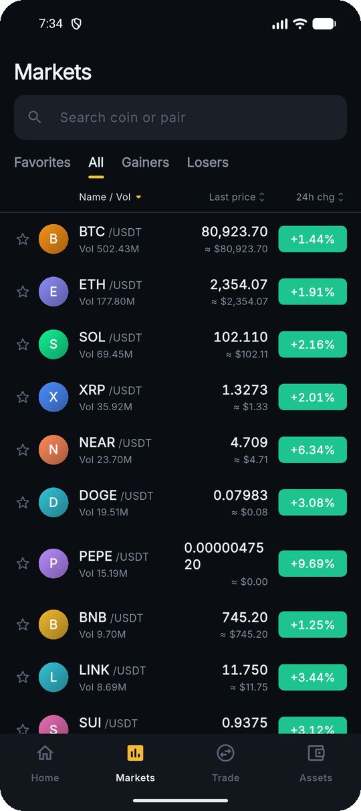
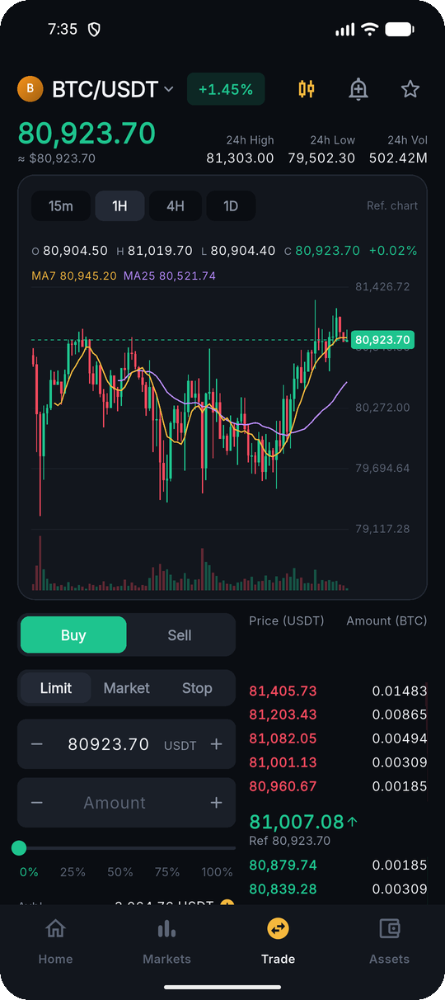
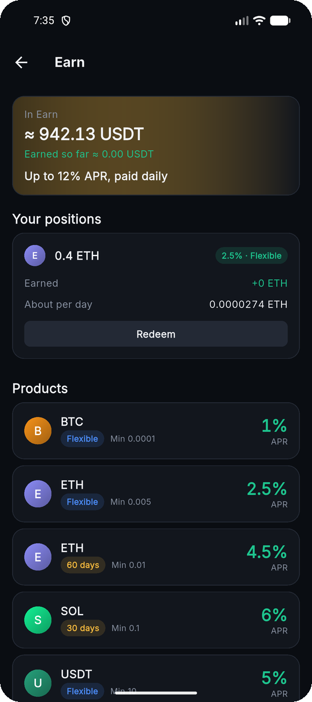
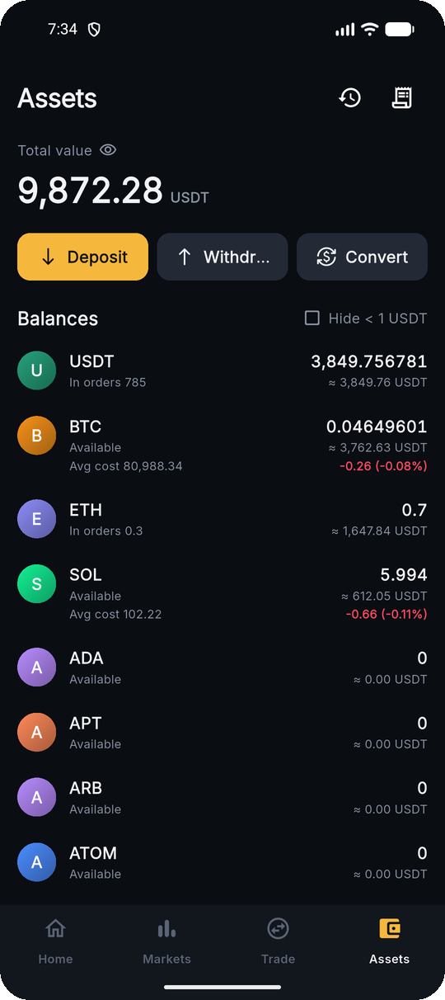
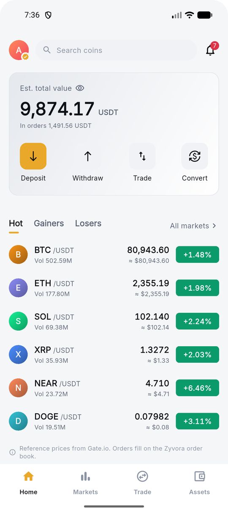
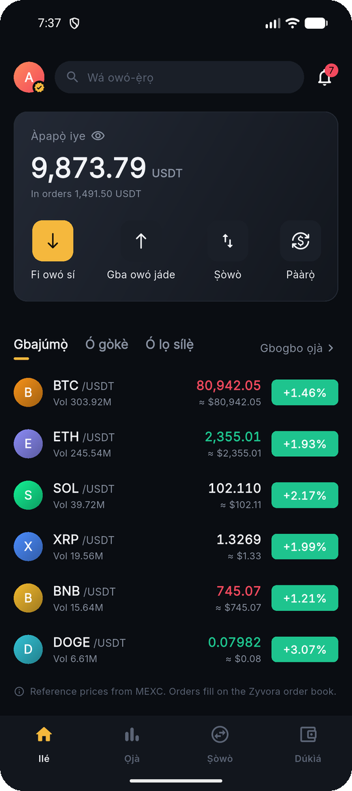
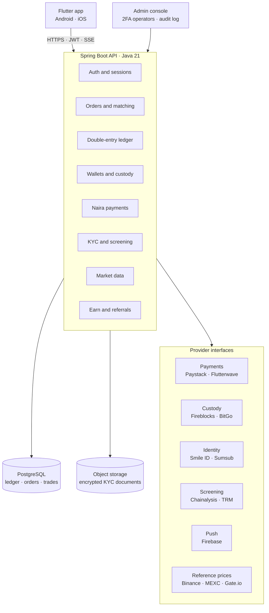
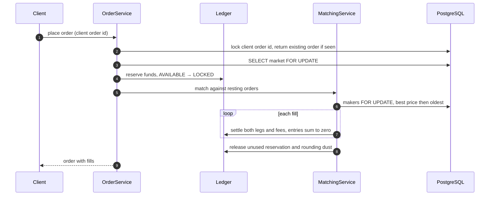

# Zyvora

A crypto exchange built for Nigeria: trade BTC, ETH, SOL, USDT and more against USDT or naira, fund your account by bank transfer, and earn interest on idle crypto.

> **The source code is private.** Zyvora is being prepared as a real product, so this repository documents the design instead: architecture, the order lifecycle, the decisions behind them, and screenshots from the running app. I'm happy to walk through the code on a call.

## At a glance

| | |
|---|---|
| **Backend** | Java 21, Spring Boot 4, PostgreSQL, Flyway · ~15k lines, 113 integration tests, 26 migrations |
| **Mobile** | Flutter (Android, iOS-ready) · ~14k lines · English, Yorùbá, Hausa and Igbo · dark and light themes |
| **Admin** | Operator console with mandatory two-factor sign-in and a full audit log |
| **Operations** | Docker image, GitHub Actions CI, Prometheus metrics, health probes, request ids on every log line |

## Screenshots

| Markets | Trade | Earn |
|---|---|---|
|  |  |  |

| Assets | Light theme | Yorùbá |
|---|---|---|
|  |  |  |

Screenshots are from the app running against the backend's sandbox providers. Prices are live reference prices; balances are sandbox funds.

## Features

**Trading**
- Price-time priority matching engine with limit, market and stop orders
- Instant convert between any two assets, with a slippage guard
- Live order book, trades and tickers over server-sent events
- Price alerts, trade history, CSV export, and profit and loss on average cost

**Money in and out**
- Naira deposits and withdrawals through a bank payment provider
- Crypto deposit addresses and withdrawals through a custody provider
- Withdrawal limits by KYC level, address screening and risk scoring

**Accounts and compliance**
- Email sign-up with verification codes, and EdDSA-signed JWTs
- KYC with document upload, encrypted before it reaches storage, and automated identity checks
- Sanctions screening on withdrawal addresses
- In-app and push notifications

**Rewards**
- Earn: flexible and fixed-term savings with daily interest
- Referrals: both people get a bonus once the invited friend verifies and trades

## Architecture

Payments, custody, identity checks, screening and push each sit behind an interface with a sandbox implementation, so the whole exchange runs end to end with no external accounts. Push notifications and reference prices are connected today; the payments, custody, identity and screening providers named above are the integration targets for launch.

## Life of an order

Placing an order, matching it and settling every fill happen in **one database transaction**.

1. **Deduplicate.** A repeated client order id returns the original order. Submissions with the same id are serialized, so the check cannot race itself.
2. **Lock the market.** The market row is locked, so exactly one transaction matches a given market at a time.
3. **Reserve funds.** The order's cost moves from `AVAILABLE` to `LOCKED`. If funds are short, the order is never written.
4. **Match.** Resting orders are crossed best price first, then oldest first. Each maker row is locked, so one cancelled mid-match is skipped.
5. **Settle each fill** at the maker's price, which is never worse than the taker's limit, as one balanced ledger transaction.
6. **Release** any unused reservation, including rounding dust, once the order is done.

## Key decisions

**A ledger that cannot drift.** Every balance change is a double-entry transaction whose entries must sum to zero for each asset. Customer accounts can never go negative. Accounts are locked in a fixed order to rule out deadlocks, and a unique reference makes every posting idempotent. A `zyvora_ledger_imbalance` metric alerts if the books ever stop balancing.

**Matching serialized in Postgres.** Rather than an in-memory engine, matching runs inside the database transaction behind a per-market row lock. It is simple to reason about and cannot double-spend, at the cost of horizontal scale. The next step is a single-writer engine per market fed by an event log.

**Reference prices never trade.** Live prices from external venues are for display only and never create ledger entries or trades. Market orders also only fill within a band around the best price, so a thin book cannot fill someone at an absurd price.

**Schema-enforced invariants.** Amounts, prices, statuses and KYC levels are guarded by `CHECK` constraints in the database as well as in code, and the schema changes only through Flyway migrations.

## Security

- Admin operators sign in with a password and a mandatory authenticator code. Five failures lock the account for 15 minutes, and session tokens are stored hashed.
- KYC documents are encrypted with AES-256-GCM before they reach object storage, so the bucket only ever holds ciphertext.
- Payment webhooks are verified by HMAC-SHA512 signature and processed once per event id.
- Every withdrawal destination is screened against sanctions lists, and limits scale with KYC level.
- Per-client rate limiting, request ids on every log line, and Prometheus metrics.
- CI runs the test suite, builds the Docker image and scans every push for committed secrets with gitleaks.

## Testing

Integration tests run against a real PostgreSQL database, not mocks. They fire concurrent orders and reservations at the same account and assert that nothing is ever spent twice, and they check that settlement and rounding leave the ledger summing to zero. The test setup refuses to run against any database whose name does not contain `test`, so a stray connection string can never wipe real data.

## Status

Feature-complete in sandbox: trading, convert, deposits and withdrawals, KYC, Earn and referrals all run end to end. Before real money it needs licensing with SEC Nigeria, live payment, custody and identity providers, and production liquidity.

---

Built by [Adewale Babalola](https://github.com/Asmodeus8) · [Portfolio case study](https://v0-devasmodeus.vercel.app/work/zyvora)
